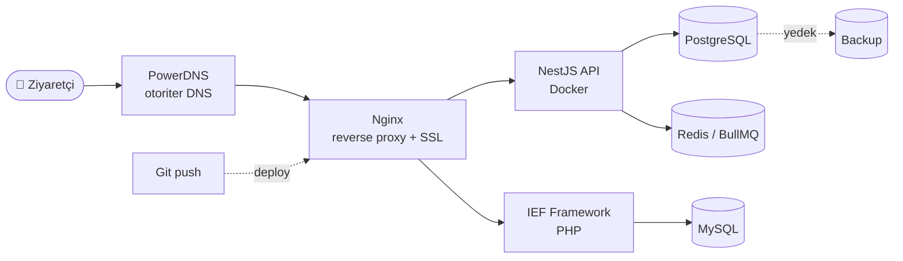

<div align="center">



[](https://iefsoftware.tr)

[](https://iefsoftware.tr)
[](mailto:iefeerd@iefsoftware.tr)
[](https://instagram.com/iefeerd)
[](https://twitter.com/motorsuruyom)

</div>


## 🧠 Hakkımda

```ts
const efe = {
  rol:        "Solo founder & developer @ IEF Software",
  konum:      "İstanbul, TR",
  since:      2019,                       // Python tooling → 2021'de web
  canliProje: "15+",
  urun:       9,
  stack:      { agir: "React · NestJS · PostgreSQL", hafif: "IEF Framework (PHP MVC)" },
  workflow:   "AI-native — Claude Code + kendi MCP sunucularım",
  altyapi:    "Kendi VPS'im + PowerDNS. Üçüncü parti hosting'e muhtaç değil.",
  motto:      "Şablon değil, sistem.",
};
```

<div align="center">

</div>


## 🚀 Ürünler

> Müşteri işi değil — sahibi biziz, satan da biziz.

| | Ürün | Ne yapıyor | Durum |
|---|------|-----------|:-----:|
| 🎓 | **[Hocalab](https://hocalab.com)** | Özel ders öğretmenleri için SaaS + pazaryeri. Öğretmene kendi sitesi, öğrenci/ödeme/takvim tek panelde, iyzico alt üye işyeri ile direkt ödeme |  |
| ⚖️ | **[Adliom](https://iefsoftware.tr/urunler/adliom)** | Hukuk bürolarına özel lisanslı CMS. Canlı editör, 10 tema + tema motoru, müvekkil portalı, KVKK/SEO/PWA, offline lisans koruması |  |
| 🔎 | **Karşı Taraf** | Avukatlar için karşı taraf araştırma SaaS'ı |  |
| 🚗 | **[Dinamo](https://dinamo.iefsoftware.tr)** | Rent a car firmaları için araç kiralama yazılımı |  |
| 🧾 | **[Mercho](https://mercho.iefsoftware.tr)** | Beden/renk/numara varyantlı satış yapan mağazalar için barkodlu stok ve satış programı. Satış, stok, kasa ve kâr takibi tek panelde |  |
| 📦 | **Bayikolay** | Toptancılar için white-label bayi sipariş + dağıtım platformu. Faturalı/faturasız bayi, iyzico, kurye rota planlama, müşteri başına izole DB |  |
| 🛠️ | **Saha** | Saha ekipleri için mobil-öncelikli PWA. İş emri, ağ krokisi, envanter + OCR, şifre kasası, dokunmatik imzalı teslim tutanağı, çevrimdışı çalışma |  |
| 🏰 | **Citadel** | Kendi PaaS / hosting panelim. Deploy, domain, DNS, SSL, veritabanı tek arayüzden |  |
| ⚙️ | **IEF Framework** | Her şeyin temeli. PHP MVC — routing, ORM, panel jeneratörü, çok dil, medya kütüphanesi |  |


## 🤖 AI-Native Çalışıyorum

Kod yazmayı bıraktım, **sistem kurmaya** odaklandım. Planlama, mimari ve ürün kararları bende; uygulama Claude Code'da faz paketleriyle akıyor. Kendi ürünlerimi de AI'ın elinin altına koyuyorum — her birinin kendi **MCP sunucusu** var:

| MCP | Ne yaptırıyor |
|-----|---------------|
| 🎓 **Hocalab OPS** | Öğretmen başvurusu kontrolü, onay, ödeme altyapısı, destek masası, KVKK talepleri |
| 📣 **Hocalab Social Agent** | Instagram kuyruğu, DM/yorum yönetimi, Meta reklam kurulumu |
| 📇 **IEF CRM** | Lead import, arama logu, atama, deploy + rollback |
| 💬 **IEF WhatsApp** | Sohbet okuma, mesaj/dosya/sesli mesaj gönderme, bilgi bankası |
| 🧾 **EDM Fatura** | e-Fatura taslağı hazırlama, sıralı numara sayacı, mükellef kontrolü |
| ⚖️ **Adliom** | Dava, süre hesabı, müvekkil, randevu, emsal karar arama |

> Sonuç: Bir sohbetten fatura kesiliyor, lead aranıyor, öğretmen onaylanıyor, deploy geri alınıyor.


## 💼 Seçilmiş Müşteri İşleri

<details open>
<summary><b>🍽️ POS / Rezervasyon</b></summary>
<br/>

| Proje | Ne yaptım |
|-------|-----------|
| 🏖️ **The ROOF Ada** | Beach club rezervasyon + POS. Görsel yerleşim planından loca yönetimi, adisyon akışı, cloud-only mimari, termal yazıcı için özel **print-agent köprüsü** |
| 🥙 **Konyalı Etli Ekmek** | Adisyon/POS sistemi. Pardus terminaller, SSH üzerinden uzaktan yönetim paneli, yazıcı kurulumu |
| 🛞 **Point Lastik** | Lastikçi için online randevu sistemi |

</details>

<details open>
<summary><b>🛒 E-ticaret / B2B</b></summary>
<br/>

| Proje | Ne yaptım |
|-------|-----------|
| 🏍️ **Moto Yedek Parça** | Araç/parça uyumluluk eşleştirmeli e-ticaret. Marka/model/yıl/motor kırılımında veri modeli, varyantlı ürün, stok + kargo |
| 🔌 **dizgiistiyorum.com** | PCB dizgi için B2B sipariş platformu |

</details>

<details open>
<summary><b>🏢 Kurumsal + Panel</b></summary>
<br/>

| Proje | Ne yaptım |
|-------|-----------|
| 🚛 **[3E Taşımacılık](https://3etasimacilik.com.tr)** | Kurumsal site + ERP/CRM. Sevkiyat, araç, müşteri, teklif takibi, WhatsApp asistanı |
| 🔧 **Vag Garaj** | VAG servisi için Next.js site + randevu/servis takip sistemi |
| 🌍 **6 dilli ihracat kataloğu** | İhracat odaklı marka için çok dilli vitrin/katalog sitesi |
| 🩺 Vetumay Veteriner · 🚦 Onur Sürücü Kursu · 💄 Helikon | IEF Framework üzerinde panelli kurumsal siteler |

</details>


## 🎮 Yan Projeler (eğlencesine)

- 🤠 **Muhtar** — Jubbio (yerli Discord alternatifi) için çok modüllü moderasyon botu. Ücretsiz, platforma açılış hediyesi
- 🃏 **Pis Yedili Online** — Arkadaş grubu için oda kodlu, gerçek zamanlı kağıt oyunu
- 🎼 **Solfej Antrenörü** — Müzisyenler için Next.js kulak eğitimi uygulaması
- 👻 **Köy Korku** — Roblox'ta co-op korku oyunu
- 📺 **Kick Overlay** — Yayıncılar için chat-etkileşimli oyun/overlay sistemi


## 🔧 İki Hatlı Stack

İşin ağırlığına göre seçiyorum, ikisini aynı işe zorlamıyorum.

| | 🏋️ Ağır iş | 🪶 Kurumsal / vitrin |
|---|---|---|
| **Stack** | React · NestJS · PostgreSQL | IEF Framework (kendi PHP MVC'im) |
| **Yapı** | Monorepo, SSR/Next.js, TypeORM | Kendi routing + ORM + panel jeneratörü |
| **Kuyruk** | BullMQ + Redis | — |
| **Frontend** | React · Next.js · Tailwind | HTMX · Tailwind |
| **Deploy** | Docker + Nginx | Paylaşımlı hosting'te bile çalışır |
| **Ne zaman** | Çok kullanıcılı, karmaşık veri, entegrasyon yoğun | Hızlı teslim, hafif, düşük bakım |

<div align="center">
<br/>


<br/>


</div>


## ☁️ Altyapı

Kendi sunucularımı ve DNS'imi yönetiyorum — müşteriyi üçüncü bir hosting firmasına muhtaç bırakmıyorum.



> Bu altyapıyı bir panele dönüştürme işi = **Citadel**


## 📂 Açık Kaynak

| Repo | Ne yapıyor | Stack |
|------|-----------|-------|
| **[ief-file-manager](https://github.com/byk1lla/ief-file-manager)** | Web tabanlı dosya yöneticisi — drag & drop, gömülü kod editörü, medya önizleme, çok dil | PHP |
| **[urlShortener](https://github.com/byk1lla/urlShortener)** | Link kısaltma servisi | PHP |


## 📊 GitHub

<div align="center">


<picture>
  <source media="(prefers-color-scheme: dark)" srcset="https://raw.githubusercontent.com/byk1lla/byk1lla/output/github-snake-dark.svg" />
  <source media="(prefers-color-scheme: light)" srcset="https://raw.githubusercontent.com/byk1lla/byk1lla/output/github-snake.svg" />
  
</picture>

</div>

<div align="center">


**📧 [iefeerd@iefsoftware.tr](mailto:iefeerd@iefsoftware.tr)** · **🌐 [iefsoftware.tr](https://iefsoftware.tr)**


</div>
